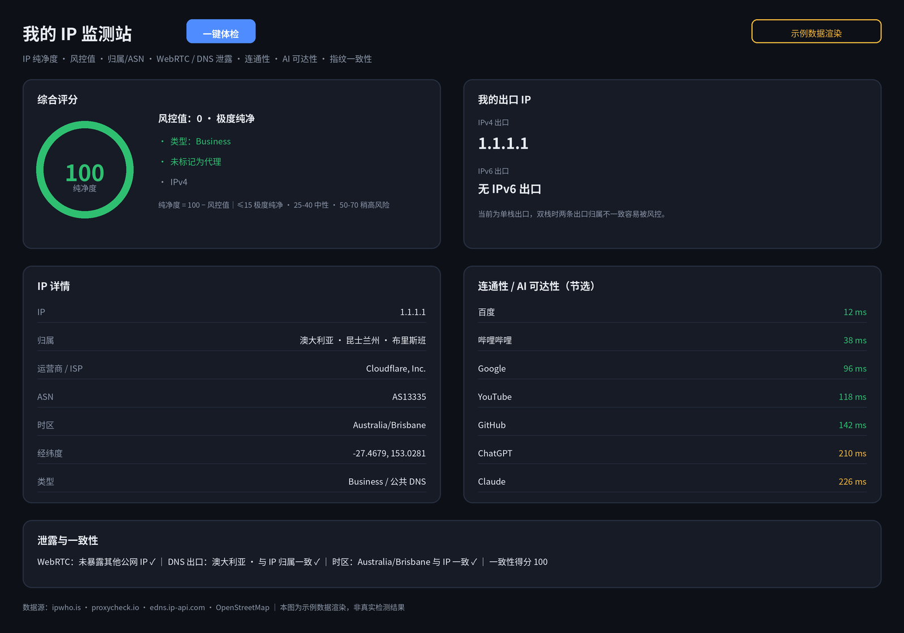

# ym-ip · 我的 IP 监测站

一站式 IP 与网络诊断工具箱：打开页面自动体检，查清一个 IP 的**纯净底色、风控评级、物理坐标与代理轨迹**。
为自己折腾优选 IP / 节点而写：综合了 One IP、IPSuper、ping0、IPCheck.ing、TcpTest、Whoer 六家站点的长处，收进一个**纯静态单文件**，零后端、零成本。
基于 **Cloudflare Pages** 部署（或本地直接打开），全部运行在免费额度内，无需服务器、无需数据库。


> 本仓库只包含代码，不包含任何人的检测数据。下方截图为**示例数据渲染**（演示 IP 为公共 DNS 地址 1.1.1.1），不是任何人的真实检测结果。
> 检测历史只存在你自己的浏览器 localStorage 里，不上传、不经过任何服务器。

**目录**：[版本亮点](#-版本亮点) · [效果预览](#-效果预览) · [特性](#-特性) · [快速部署](#-快速部署) · [使用方法](#-使用方法) · [评分口径](#-评分口径) · [与同类站点对比](#-与同类站点对比) · [常见问题](#-常见问题) · [隐私与安全](#-隐私与安全) · [已知边界与路线图](#-已知边界与路线图) · [版本历史](#-版本历史)

---

## 🌟 版本亮点

- **一个页面全测完**：出口 IP、纯净度、风控、泄露、连通性、AI 可达性、指纹一致性，点一次「一键体检」并行跑完，不用在六个网站之间来回跳
- **双出口并显**：IPv4 / IPv6 两条出口分开测、分开展示，双栈归属不一致会直接提醒（这是很多风控的隐形扣分项）
- **批量筛节点池**：一行粘贴最多 10 个 IP，归属 / 类型 / 风控 / 纯净度一表出，筛优选 IP、筛节点时不用一个个查
- **报告可导出**：本次检测一键导出 JSON，存档、发人复核都方便
- **代码与数据彻底分离**：仓库只有 `index.html`，你的 IP 与历史只活在你自己的浏览器里

---

## 🖼 效果预览



页面自上而下：综合评分 + 双出口 → IP 详情 + 地图 → 查任意 IP → 批量查 IP → 连通性 / AI 可达性 → 泄露检测 + 指纹一致性 → 检测历史。

---

## ✨ 特性

### 🧪 综合评分（学 IPSuper 的安全分 + ping0 的风控分档）

- **纯净度圆环**：0–100，越高越干净；配色随分数变（绿 → 黄 → 红）
- **风控值分档**：沿用 ping0 的六档口径：≤15 极度纯净 · 15–25 纯净 · 25–40 中性 · 40–50 轻微风险 · 50–70 稍高风险 · >70 极度风险
- **类型标签**：住宅 / 机房 / VPN / 代理判定 + 「是否被标记为代理」单独成标，不藏着

### 🌐 出口与画像（学 One IP 的双探针 + ping0 的单 IP 画像）

- **IPv4 / IPv6 双出口**：分别探测，归属、运营商、ASN、组织、时区、经纬度、邮编全列
- **位置地图**：OpenStreetMap 嵌入定位，不用任何地图密钥
- **查任意 IP**：输入任意 IPv4 / IPv6 出完整画像（归属 / ISP / ASN / 类型 / 风控 / 纯净度）
- **批量查 IP**：最多 10 个并排对比，按纯净度挑优先顺序

### 🚀 连通性与 AI（学 TcpTest 的延迟表 + One IP 的 AI 状态聚合）

- **站点延迟**：百度、淘宝、哔哩哔哩、知乎、Google、YouTube、GitHub、Cloudflare、X、维基百科，从你的浏览器实测响应时间——测的是你这台设备、这条线路的真实体感
- **AI 服务可达性**：ChatGPT、Claude、Gemini、Grok、DeepSeek、Kimi 逐个探活，并标注服务方所在地（能不能用还要结合出口地区是否在支持范围内）

### 🕵️ 泄露与指纹（学 IPCheck.ing 的泄露检测 + Whoer 的逐项扣分）

- **WebRTC 检测**：暴露的公网 IP、内网 IP 都列出来，并与出口 IP 比对判定是否泄露
- **DNS 出口检测**：查实际解析你的 DNS 出口 IP 与归属，国家与 IP 归属不一致即提示泄露风险
- **环境一致性评分**：浏览器时区 vs IP 时区、语言地区 vs IP 归属、WebRTC、DNS 四项逐项核对，不一致逐项扣分并写明原因（满分 100）
- **指纹明细**：UA、平台、屏幕、CPU 核数、内存、GPU 渲染器一屏看全

### 🗂 历史与导出（学 MyIP 的本地历史）

- **检测历史**：最近 10 次（时间 / IP / 归属 / 风控值），只存本地浏览器
- **导出报告**：当前检测结果导出为 JSON 文件

---

## 🚀 快速部署

本站是**单个 `index.html`**，没有任何构建步骤，三条路任选：

### 方式 A：Cloudflare Pages 连接 GitHub（推荐，三分钟）

1. 登录 [Cloudflare 后台](https://dash.cloudflare.com) →「Workers 和 Pages」→「创建」→「Pages」→「连接到 Git」
2. 选择本仓库 `ym-ip`
3. 构建设置：**框架预设选「无」，构建命令留空，输出目录填 `/`**（纯静态，不要画蛇添足）
4. 保存并部署，得到一个 `xxx.pages.dev` 地址，打开能测即成功
5. （可选）项目 →「自定义域」→ 绑定自己的子域名，例如 `ip.example.com`，DNS 与 HTTPS 证书自动完成

之后每次往仓库推新版，Pages 自动重新部署。

### 方式 B：Cloudflare Pages 直接上传

「创建 → Pages → 上传资产」，把 `index.html` 打包成 zip 拖上去即可，后续更新重复此步。

### 方式 C：本地打开

把 `index.html` 存到电脑 / 手机，用浏览器打开就能测。个别接口在本地文件协议下可能受限，**部署成 https 后最稳**。

### 免费额度说明

| 项目 | 免费额度 | 本站用量 |
| --- | --- | --- |
| Cloudflare Pages | 静态请求不限量、每月 500 次构建 | 一个静态文件，几乎为零 |
| ipwho.is | 免费、无需密钥 | 每次体检 1–2 次请求 |
| proxycheck.io | 无密钥免费档（按 IP 每日限量） | 每次体检 1 次、批量查询每个 IP 1 次 |
| edns.ip-api.com / OpenStreetMap | 免费公开服务 | 每次体检各 1 次 |

---

## 📖 使用方法

- **打开即测**：页面加载后自动跑一遍完整体检；换了节点 / 网络后点「一键体检」重测
- **查别人的 IP**：「查任意 IP」输入单个地址；「批量查 IP」粘贴一串地址（空格或逗号分隔）
- **看分数**：先看纯净度圆环和风控分档，再看类型标签；分数存疑时用页脚的 ping0 / IPSuper / Scamalytics 链接交叉复核
- **存档**：点「导出报告」把本次结果存成 JSON

---

## 📏 评分口径

**纯净度 = 100 − 风控值。** 风控值优先取 proxycheck.io 风险库（基于其蜜罐与滥用监测）；风险库不可用时，回退为本地启发式推测（按 ASN / 组织名中的机房、云厂商关键词判定类型再给分），页面上会注明分数来源，不糊弄。

| 风控值 | 分档 | 建议 |
| --- | --- | --- |
| ≤15 | 极度纯净 | 放心用 |
| 15–25 | 纯净 | 正常使用 |
| 25–40 | 中性 | 一般用途没问题 |
| 40–50 | 轻微风险 | 重要账号谨慎 |
| 50–70 | 稍高风险 | 只作临时 / 备用 |
| >70 | 极度风险 | 建议直接放弃 |

**数据源一览**：归属 / ASN / 时区 / 经纬度 — ipwho.is；风险值 / 代理判定 — proxycheck.io；DNS 出口 — edns.ip-api.com；IPv4 / IPv6 探测 — ipify；地图 — OpenStreetMap。

> 各家的风险分是各自数据库 + 各自模型的结果，**不同站点的分数不能横向直接比较**；同一 IP 在本站与 ping0、IPSuper 之间差个十几分属于正常现象，看分档、看标签，比盯着个位数更有用。

---

## 🔀 与同类站点对比

| 功能 | ym-ip | One IP | ping0 | IPSuper | IPCheck.ing | TcpTest |
| --- | --- | --- | --- | --- | --- | --- |
| 纯净度 / 风控评分 | ✅ | ✅ | ✅ | ✅ | ✅ | — |
| IPv4 / IPv6 双出口 | ✅ | ✅ | 部分 | 部分 | ✅ | — |
| 查任意 IP / 批量查 | ✅ | ✅ | ✅ | ✅ | ✅ | 域名为主 |
| 连通性延迟 | ✅ 本机实测 | ✅ | ✅ | — | ✅ | ✅ 多地探针 |
| AI 服务可达性 | ✅ | ✅ | 部分 | — | 部分 | — |
| WebRTC / DNS 泄露 | ✅ | ✅ | 部分 | — | ✅ | — |
| 指纹一致性扣分 | ✅ | 部分 | 部分 | — | ✅ | — |
| 检测历史 / 报告导出 | ✅ | — | — | — | 部分 | — |
| 自部署、数据归自己 | ✅ 单文件 | ✅ | — | — | ✅ | — |

本站的取舍：**广度向 One IP / IPCheck.ing 看齐，评分口径向 ping0 看齐，呈现方式向 IPSuper 看齐**；多地 Ping / MTR 这种需要服务器探针网络的功能不做（见「已知边界」）。

---

## ❓ 常见问题

**Q：分数和 ping0 / IPSuper 对不上，哪个准？**
A：没有绝对的「准」。各家数据库不同、模型不同，分档一致就算互相印证；差一档以上时，以你要用的那个平台的实际反馈为准，多站交叉看。

**Q：连通性测速和 TcpTest 的结果为什么不一样？**
A：TcpTest 是它分布在各地的服务器探针在测；本站是你自己的设备在测。前者看「这个 IP 在全国快不快」，后者看「在你家、你这条宽带上快不快」——你要用的是后者。

**Q：IPv6 出口显示「无 IPv6 出口」？**
A：说明你当前网络没有 IPv6 公网出口（运营商未下发或路由器未开启），属正常现象，不是报错。

**Q：WebRTC 显示的内网 IP 是泄露吗？**
A：内网地址（192.168.x / 10.x）暴露给网页是 WebRTC 的常见行为，一般不构成风险；真正要警惕的是它暴露了与出口不一致的**公网** IP，本站会单独标红提示。

**Q：批量查询一次查不了太多？**
A：免费风险库按 IP 限量，批量上限设为 10 个/次；真要筛大池子，分批粘贴即可。

**Q：检测历史会被别人看到吗？**
A：不会。历史只写在你当前浏览器的 localStorage 里，换浏览器、清缓存即消失，更不会进仓库。

---

## 🔒 隐私与安全

- 本站是纯静态页面，**没有任何后端**，不收集、不上传你的检测记录
- 页面会向数据源接口（ipwho.is、proxycheck.io 等）发出查询请求，对方因此能看到你的出口 IP——这正是查询本身所必需的，与在任何同类网站查询无异
- 仓库公开可见，但只包含代码；你的数据只存在你自己的浏览器与你自己的 Cloudflare 账号里

---

## 🧭 已知边界与路线图

**已知边界（纯前端做不到的事，先说清）**

- 真·多地 Ping / MTR / 路由追踪需要服务器探针网络，纯静态页面无解，需要时请用 TcpTest
- 服务端测速（下载 / 上传带宽）需要测速节点，本站只测延迟与可达性
- 风险分依赖第三方免费库的可用性与限量，库不可用时自动降级为启发式推测并注明来源

**路线图**

- [ ] DNS 多探针交叉（多个 DNS 出口源互相印证）
- [ ] 优选 IP 清单模式：粘贴 `IP:端口#地区` 清单，逐条出画像
- [ ] 结果卡片图导出（把体检结果生成一张可分享的图片）
- [ ] 深浅色主题切换

---

## 📜 版本历史

- **v1.1（2026-11-06）**：新增批量查 IP、导出检测报告；补全 README 与效果预览图
- **v1.0（2026-11-06）**：首版。综合评分、双出口、IP 画像、连通性、AI 可达性、WebRTC / DNS 泄露、指纹一致性、本地历史

---

## 文件结构

```
ym-ip/
├── index.html    # 全部功能就这一个文件（样式、脚本全内联）
├── preview-v2.png   # 效果预览图（示例数据渲染）
└── README.md     # 本文件
```
